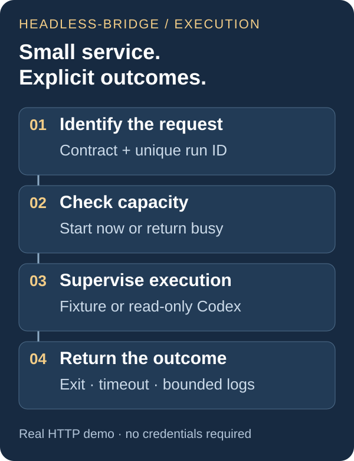

# headless-bridge

### Run a CLI task. Keep the service responsive. Explain the result.

A small Python HTTP service for supervised command-line execution. It gives each run an identity, keeps long-running work off the request event loop, and returns a clear outcome when a process succeeds, fails, times out, or cannot start.

**Try it without credentials.** The default backend launches deterministic local fixture processes. An explicitly enabled Codex backend uses the same execution path with read-only CLI access.

[Run the demo](#try-the-complete-flow) · [Explore the design](docs/ENGINEERING.md) · [Inspect recorded results](docs/demo-results.windows.json)



## Try the complete flow

In a **Python 3.13+ virtual environment**, from the repository root:

```sh
python -m pip install -r requirements.txt
python -m examples.demo
```

The demo starts a temporary loopback HTTP server, runs real local subprocesses, checks success / failure / timeout / busy responses, and stops the server. No API key, Codex installation, or model call is needed. Save your own result with:

```sh
python -m examples.demo --output demo-results.json
```

To explore the API yourself, run `python main.py` and open **http://127.0.0.1:8000/docs**. The fixture backend is selected by default.

## What a caller can observe

| Situation | HTTP | Result reason |
| --- | --- | --- |
| Process exits normally | 200 | `completed` |
| Process returns a nonzero code | 200 | `nonzero_exit` |
| Deadline expires | 504 | `timeout` |
| Capacity is occupied | 429 | `busy` |
| Configured Codex executable is missing | 503 | `executor_unavailable` |
| Local supervision/setup fails | 500 | `execution_error` |

Every admitted or busy run carries `run_id` and `meta.contract_id`. Results include elapsed time, exit code when available, capped stdout/stderr, and an explicit truncation flag. `meta.fixture` tells you whether the output came from the demonstration backend.

A completed process is a process result; acceptance of a repaired project belongs to the caller's checks.

## Engineering in a small package

- **Responsive HTTP.** Blocking process supervision runs in a worker thread; the health route remains available during a slow run.
- **Bounded work.** One active run by default, explicit busy responses, a deadline, and bounded capture of both output streams. No background queue or database.
- **Owned process lifetime.** A worker waits behind an input gate until its Windows Job Object or POSIX process group is established. Descendants are cleaned up after timeout and normal completion.
- **Reproducible evidence.** HTTP integration tests exercise failures and cleanup; the demo produces a readable JSON record.

Built by **Yifang Li**. This iteration focuses on Python service integration, process lifecycle, failure semantics, and verification.

## Read the code

- [API contract and prompt construction](adapters/codex/handler.py)
- [Capacity, supervision and bounded output](core/runner.py)
- [Process lifetime management](core/process_tree.py) and [startup gate](core/worker.py)
- [HTTP integration tests](tests/test_service.py)
- [Configuration, real Codex mode and compatibility](docs/ENGINEERING.md#run-modes-and-configuration)

Run the checks with `python -m unittest discover -s tests -v`. [CI](https://github.com/li1fang/headless-bridge/actions) runs the credential-free tests and demo on Windows and Linux.

## Scope and history

This is a local, trusted-caller bridge. The default server binds to loopback and uses one worker. Process cleanup is not a security sandbox; public hosting and multi-tenant execution are outside this project.

The earlier deployment manifests and README remain in [history](docs/history/README.md). Version 0.2 replaces the old prompt-driven download/execute chain with a read-only Codex analysis mode; repository/tool URLs are context, not service-managed downloads. The standalone `rget` script remains separate from the service.

No open-source license has been specified; contact the maintainer regarding reuse.
